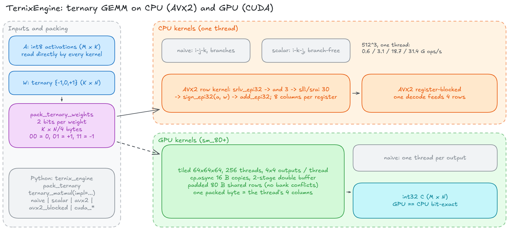
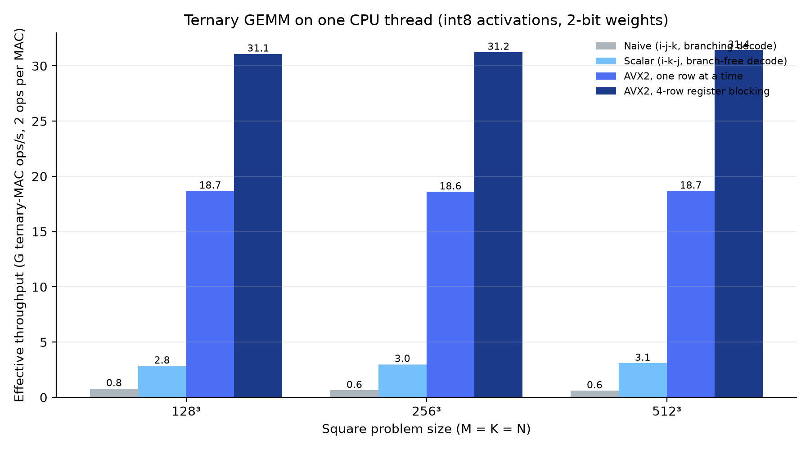
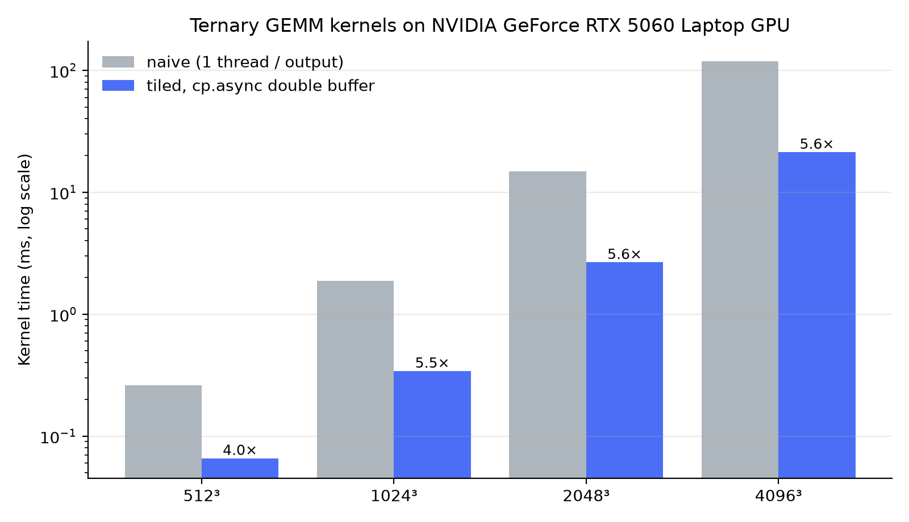

# TernixEngine
**1.58-bit ternary GEMM kernels for CPU (AVX2) and GPU (CUDA), with a NumPy-friendly Python API**
*Distributed under the Elastic License 2.0 (see [License](#12-license)).*

   

## Abstract
TernixEngine is a C++20 / CUDA kernel library for the core operation of 1.58-bit (ternary) LLM inference: multiplying int8 activations by weights restricted to {-1, 0, +1} and stored at 2 bits each. The kernels never unpack weights to int8/FP16 arrays, never multiply, and have no weight-dependent branches in their inner loops:

* **CPU (AVX2):** weights are decoded inside a 256-bit register (`_mm256_srlv_epi32` + shift/arithmetic-shift) and applied to the activations with `_mm256_sign_epi32`; a register-blocked variant reuses each decoded weight vector for four activation rows.
* **GPU (CUDA):** a 64x64x64 block-tiled kernel streams int8 activations and packed weights global->shared with `cp.async` through a two-stage double buffer; each thread owns a 4x4 output micro-tile and one packed weight byte covers its four columns.
* Every kernel is checked **bit-exactly** against an independent integer GEMM on the unpacked weights, from C++ (GoogleTest), from Python (NumPy), and GPU-vs-CPU.

> **Status: active research and development.** This repository is a *kernel library*, not yet an end-to-end LLM runtime: the weight quantizer (`scripts/quantize.py`) and the model loader / transformer block are stubs, and the dense BitNet block (attention + FFN) is future work. See [Current status](#10-current-status).

## Table of Contents
1. [The bottleneck](#1-the-bottleneck-de-quantization-wall--warp-divergence)
2. [Kernel design](#2-kernel-design)
3. [Conceptual overview](#3-conceptual-overview)
4. [System architecture](#4-system-architecture)
5. [Directory structure](#5-directory-structure)
6. [Technology stack](#6-technology-stack)
7. [Testing and CI](#7-testing-and-ci)
8. [Build and run](#8-build-and-run)
9. [Benchmarks](#9-benchmarks)
10. [Current status](#10-current-status)
11. [Limitations and future work](#11-limitations-and-future-work)
12. [License](#12-license)

## 1. The bottleneck: de-quantization wall & warp divergence
Engines that evaluate sub-byte LLMs usually (1) unpack 2-bit weights into int8/FP16 before the GEMM loop, which saturates L1 bandwidth and stalls the ALUs (the *de-quantization wall*); (2) skip zero weights with scalar branches (`if (w == 0)`), which defeats the branch predictor on data-dependent patterns; and (3) on GPUs, issue unaligned sub-byte global loads that diverge warps and break coalescing.

## 2. Kernel design
All kernels compute `C[M,N] (int32) = A[M,K] (int8) x W[K,N]`, with `W` packed four ternary values per byte as a row-major `K x (N/4)` array (`00 -> 0`, `01 -> +1`, `11 -> -1`). The same layout feeds every implementation.

| Kernel | File | Idea |
|---|---|---|
| `mul_mat_ternary_naive` | `src/mul_mat_ternary.cpp` | Reference: i-j-k loops, branching decode. Deliberately cache-hostile (strides down a column of `W`). |
| `mul_mat_ternary_scalar` | same | Strong scalar baseline: i-k-j order, branch-free decode `w = (b & 1) - (b & 2)`. |
| `mul_mat_ternary_avx2` | same | One output row at a time; 8 columns per register; `srlv` decode + `sign_epi32`; M->K->N tiling keeps eight int32 accumulators in a register across K. |
| `mul_mat_ternary_avx2_blocked` | same | 4 rows per pass: one decode feeds four accumulators. |
| `mul_mat_ternary_cuda_naive` | `src/cuda_kernels.cu` | One thread per output; baseline for the GPU numbers. |
| `mul_mat_ternary_cuda_tiled` | same | 64x64x64 tiles, 256 threads, 4x4 outputs/thread, **`cp.async` 16-byte copies in a 2-stage pipeline** (`wait_group 1` overlaps tile t+1 with math on tile t), padded 80-byte shared rows to avoid bank conflicts. Requires M, N, K multiples of 64. |

`RMSNorm` has a real AVX2+FMA implementation (`rms_norm_avx2`, tested against the scalar version for ragged sizes); `swiglu` is scalar.

## 3. Conceptual overview
Restricting weights to {-1, 0, +1} turns every multiply into an add, a subtract or nothing. Packing four such weights per byte cuts weight traffic 8x versus FP16. The kernels keep that advantage by decoding weights in registers (CPU) or in the thread that consumes them (GPU) rather than materialising unpacked tensors.

## 4. System architecture


The Python API (`ternix_engine`) packs NumPy weights and dispatches to any CPU or CUDA kernel; the C++ core exposes the same kernels to GoogleTest and the Google Benchmark / CUDA-event harnesses. `Model`/`Transformer` are placeholders for the future end-to-end path.

## 5. Directory structure
```text
TernixEngine/
├── include/ternix/        # public headers (kernels, bit-packing, SIMD math, tensor, CUDA API)
├── src/
│   ├── mul_mat_ternary.cpp   # naive / scalar / AVX2 / AVX2-blocked CPU kernels
│   ├── cuda_kernels.cu       # naive and cp.async-tiled GPU kernels + host wrappers
│   ├── bitpack.cpp           # 2-bit pack / unpack
│   ├── simd_math.cpp         # RMSNorm (AVX2+FMA), SwiGLU
│   ├── tensor.cpp            # 32-byte-aligned, move-only tensor storage
│   └── model.cpp, transformer.cpp, main.cpp   # stubs for the future runtime
├── bindings/python/       # PyBind11 module: pack/unpack, ternary_matmul(impl=...), Model
├── tests/                 # GoogleTest (CPU, CUDA) and pytest (binding) suites
├── benchmarks/            # Google Benchmark (CPU) and CUDA-event (GPU) harnesses, generated charts
├── scripts/               # plot_results.py (charts + README tables), quantize.py (stub)
├── docs/                  # research synthesis, architecture diagram
├── CMakeLists.txt, run_all.bat, run_all.sh
└── .github/workflows/ci.yml
```

## 6. Technology stack
C++20 (MSVC, GCC, Clang), AVX2/FMA intrinsics, CUDA (sm_80+, `cp.async`), PyBind11, CMake + Ninja, GoogleTest, Google Benchmark, pytest/NumPy. Dependencies are fetched with CMake `FetchContent`.

## 7. Testing and CI
* **C++ (`ternix_tests`):** every CPU kernel vs an independent integer GEMM on unpacked weights over ragged shapes (incl. `M` not a multiple of the row block, `K` not a multiple of 8) and an int8-extreme/K=4096 overflow case; pack/unpack round trip; RMSNorm AVX2 vs scalar.
* **CUDA (`ternix_cuda_tests`):** both GPU kernels vs the CPU reference, bit-exact, including 64x4096x64 (many pipeline iterations); shape validation.
* **Python (`tests/test_python_binding.py`):** all CPU and CUDA implementations vs `numpy`, input validation.
* **CI (`.github/workflows/ci.yml`):** Linux (GCC) and Windows (MSVC) build + all CPU tests + binding tests + benchmark smoke run; a CUDA container job compiles the GPU code for sm_80/86/89/90 (hosted runners have no GPU, so GPU *execution* is verified locally).

## 8. Build and run
Requirements: a C++20 compiler with AVX2, CMake >= 3.20, Ninja (optional), Python 3.9+ with NumPy for the bindings, and optionally the CUDA toolkit (sm_80+ GPU to run the CUDA tests).

```bash
# Linux / WSL
./run_all.sh
```
```bat
:: Windows (x64 Native Tools Command Prompt for VS)
run_all.bat
```
Both scripts configure, build, run all unit tests, run the Python tests, run the benchmarks (median of 5 repetitions, pinned to a P-core via `TERNIX_BENCH_CPU`), and regenerate the charts and tables below.

```python
import numpy as np, ternix_engine as tx          # build/ on PYTHONPATH
a = np.random.randint(-128, 128, (64, 256), dtype=np.int8)
w = np.random.randint(-1, 2, (256, 128), dtype=np.int8)
c = tx.ternary_matmul(a, tx.pack_ternary(w), impl="avx2_blocked")   # or naive | scalar | avx2 | cuda_naive | cuda_tiled
assert (c == a.astype(np.int32) @ w.astype(np.int32)).all()
```

## 9. Benchmarks
*Testbed: Intel Core i7-14650HX (single thread, pinned to a P-core), NVIDIA GeForce RTX 5060 Laptop GPU (sm_120), MSVC 19.5 / CUDA 13.3. These tables are regenerated by `run_all`.*

### CPU
<!-- BENCH_CPU_START -->
CPU: 24 logical cores, one thread, release build. Seeded random int8 activations and random ternary weights (identical for every kernel).

| Kernel | 128³ ms | 256³ ms | 512³ ms | G ops/s @ 512³ | vs naive @ 512³ |
|---|---:|---:|---:|---:|---:|
| Naive (i-j-k, branching decode) | 5.31 | 53.12 | 445.31 | 0.60 | 1.0× |
| Scalar (i-k-j, branch-free decode) | 1.47 | 11.23 | 86.81 | 3.09 | 5.1× |
| AVX2, one row at a time | 0.22 | 1.80 | 14.38 | 18.67 | 31.0× |
| AVX2, 4-row register blocking | 0.13 | 1.07 | 8.54 | 31.43 | 52.1× |
<!-- BENCH_CPU_END -->



### GPU
<!-- BENCH_GPU_START -->
GPU: NVIDIA GeForce RTX 5060 Laptop GPU (sm_120). CUDA-event kernel time, data resident on device, median of 31 launches; every result is checked bit-for-bit against the CPU kernel.

| Size | naive ms | tiled (cp.async) ms | speed-up | tiled effective TOPS |
|---:|---:|---:|---:|---:|
| 512³ | 0.261 | 0.066 | 4.0× | 4.08 |
| 1024³ | 1.866 | 0.341 | 5.5× | 6.29 |
| 2048³ | 14.853 | 2.657 | 5.6× | 6.47 |
| 4096³ | 118.893 | 21.280 | 5.6× | 6.46 |
<!-- BENCH_GPU_END -->



Notes on reading the numbers:
* The "naive" reference is intentionally the textbook loop order and is cache-hostile; the **scalar** row is the fair baseline for the SIMD speed-up.
* GPU timings are kernel-only (data resident on device). The GPU "TOPS" count 2 ops per ternary MAC and are *effective* rates, not tensor-core int8 peaks; the kernel uses CUDA cores and has not been compared with cuBLAS/cuBLASLt int8.
* Single-thread CPU numbers on hybrid parts depend on core placement; unpinned runs can be several times slower on an E-core.

## 10. Current status
**Working and verified:** bit-packing; naive/scalar/AVX2/AVX2-blocked CPU GEMM; naive and `cp.async`-tiled CUDA GEMM; AVX2+FMA RMSNorm; PyBind11 module exposing the kernels; test suites; CI; benchmark + chart pipeline.

**Not yet implemented (active R&D):**
* `scripts/quantize.py` is a stub: no HuggingFace weight loading, BitNet absmean scaling, or packing of a real checkpoint.
* `Model::load` and `TransformerLayer::forward` are stubs; there is no attention/FFN forward pass or tokenizer path, so there are no tokens/s numbers.
* `interleave_weights_offline` is an identity copy: the current layout is plain row-major packing along N, not a T-MAC-style interleaving or LUT scheme.

## 11. Limitations and future work
1. **End-to-end path:** quantizer, model loader, BitNet block (attention + SwiGLU FFN), KV cache, tokens/s benchmark.
2. **CPU:** AVX-512 VNNI (`_mm512_dpbusd_epi32`) variant; multi-threading over M (OpenMP is already linked); LUT-based kernels (T-MAC, QuIP# codebooks).
3. **GPU:** tensor-core (`mma.sync`) int8 path, `ldmatrix`-friendly layouts, ragged-shape tiles, comparison against cuBLASLt int8, CUDA-graph integration.
4. **Accuracy:** perplexity checks against a real BitNet b1.58 checkpoint once the quantizer exists.

## 12. License
Distributed under the **Elastic License 2.0**: you may view, use and modify the code, and share it with attribution; you may not offer it to third parties as a hosted or managed service or circumvent license-key functionality. See `LICENSE`. Provided as-is without warranty.

```bibtex
@software{ternix_engine_2026,
  author = {Tripathi, Pundarikaksh N.},
  title  = {TernixEngine: Ternary GEMM Kernels for CPU and GPU},
  year   = {2026},
  url    = {https://github.com/Quiet-Intelligence/TernixEngine}
}
```
